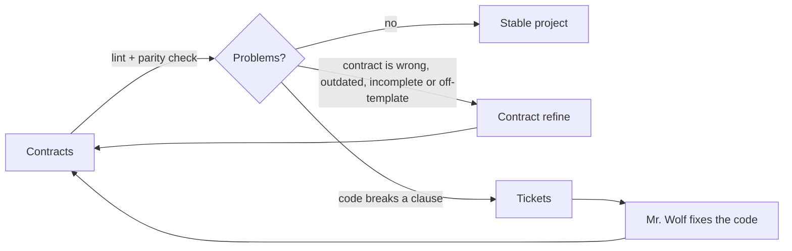
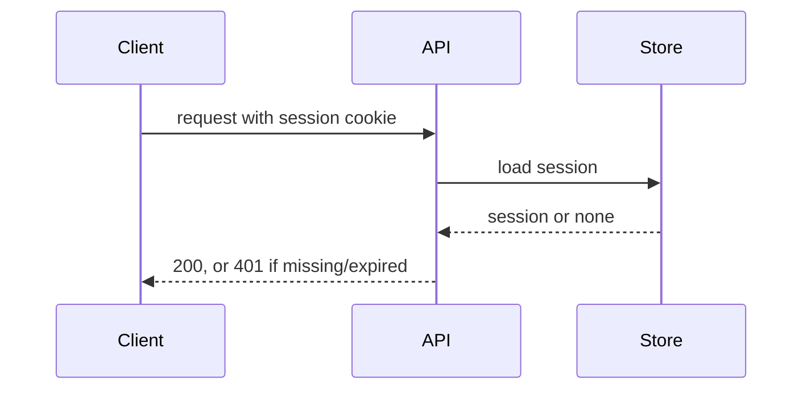

<!-- contract-flow-workspace -->
# Contract-flow workspace

This folder holds the **contracts** that document this project, the **tickets** that track where the project does not match them yet, and the **handoffs** that let a new session pick up where the last one stopped. The checks that verify the contracts live in the tests folder named in the configuration.

## How the flow works



| Problem | Solved by |
|---|---|
| The contract does not reflect the latest requests | `contract-refine` |
| The contract does not follow the template | `contract-refine` |
| Something the parts do or expose has no clause (a gap) | `contract-refine` |
| The code breaks a clause | `parity-check`, then a code ticket, solved by Mr. Wolf |

1. A **contract** documents one part of the project: what it is for, how it works (shown with diagrams and tables), and the **clauses** that bind the parts it enforces. It is written to be read by a person, not only checked by a tool.
2. A contract leaves **no grey zone**: everything the parts do, expose, accept, return or must never do is covered by a clause, or declared out of the contract with the reason.
3. Contracts are nested: the root documents the whole system, its children document its parts, down to single files. Every file of the contracted domain is enforced by some contract.
4. Every clause has a **verification**: how it is proven, with a type chosen from a closed list. A clause that cannot be verified is not accepted.
5. **`contract-lint`** checks that every contract and ticket follows the template. A contract that fails it is sent to `contract-refine` before anything else is checked.
6. A **parity check** runs the verifications and lists every discrepancy. On request, discrepancies become **tickets**.
7. The project is **stable** when every contract passes the lint, every clause passes and no file is uncontracted.

To start or resume, run `/contract-flow`.

## Configuration

<!-- Filled in by contract-init. Edit by hand or rerun contract-init. -->

| Setting | Value |
|---|---|
| Workspace | {{this folder}} |
| Tests folder | {{where verification scripts and check files live}} |
| Script runner | {{how scripts are run, e.g. `bash`, `pwsh`, `python`, `npm test --`}} |
| Contracted domain | {{paths governed by contracts}} |
| Excluded | {{paths out of scope, never reported as uncontracted, or "none"}} |
| Extra verification types | {{types added to the closed list below, or "none"}} |
| Hooks | {{where verifications also run, e.g. CI, pre-commit, or "none"}} |
| Existing documentation | {{docs that already exist and what they contain}} |

## Folders

| Folder | Contents |
|---|---|
| `contracts/` | The contract tree. The children of `x.md` live in the folder `x/` next to it. |
| `tickets/` | One file per ticket, `T-<name>.md`. Closed tickets stay here with their status. |
| `handoff/` | Session handoffs. The most recent one says what to do next. |
| tests folder | `contract-lint.py`, plus one verification per clause: `<contract id>/<clause name>.<ext>`. |

## Names

Clauses and tickets are named, never numbered.

| Rule | Example |
|---|---|
| At most **3 words**, joined by `_`, only `a-z`, `0-9` and `_` | `session_expires`, `T-timeout_too_long` |
| Written in the language of the project | |
| Describes what it means, so a reader of another contract understands a reference without opening it | |
| A clause name is unique inside its contract; a ticket name is unique in the project | |
| If a name is taken, reword it, never add a number | |
| A name never changes once written, unless every reference is updated | |

A clause is referred to as `<contract id>#<clause name>`, e.g. `system/auth/session#session_expires`. A ticket is referred to by its ID, e.g. `T-timeout_too_long`.

## Contract tree

```
contracts/
├── system.md              id: system (the root)
└── system/
    ├── auth.md            id: system/auth
    ├── auth/
    │   └── session.md     id: system/auth/session
    └── billing.md         id: system/billing
```

- A contract's **ID is its path** inside `contracts/` without `.md`. Its parent is the contract named after the folder it sits in.
- A contract with no children is a single file; its folder is created with its first child.
- **New abstraction level.** When a contract grows too large to read in one go (roughly: more than ~300 lines, more than ~15 enforced files, or several parts a reader would want to study separately), it is split: the contract keeps the overview and its children take the detail. The split is always proposed and confirmed, never automatic.
- **Coverage.** Every file of the contracted domain that is not excluded must be enforced by at least one leaf contract. A file enforced by no contract is an **uncontracted zone**.

## Contract format

A contract has **five sections in a fixed order** and a **fixed header**. These are the only rigid parts. Inside the sections, write freely, at the abstraction level of the contract, as long as it is shown more than told.

### Writing rules

- **Simple language.** Short sentences, everyday words. One idea per paragraph.
- **Show, don't only tell.** Prefer a diagram or a table to a list, and a list to a paragraph. Use:
  - `mermaid` diagrams for flows, sequences, states, dependencies, structure
  - tables for options, fields, parameters, states, responsibilities, views of the same data from different sides
  - trees (code blocks) for folder layouts
  - short code snippets for interfaces and examples
- **No grey zones.** Before writing the clauses, list every responsibility, entry point, input, output, error case, configuration and dependency of the parts at this level. Each one gets a clause, or is declared out of the contract with the reason. Detail too fine for this level goes into a child contract.
- **Few entries, each useful.** A table row or a note that nobody could act on or verify is removed.
- **No undefined terms.** A term whose meaning the text does not explain goes into **Notes**.

### Template

~~~markdown
---
name: Session handling            # at most 3 words
realizes: [system/auth]           # contracts this one respects (its parent and any other); empty only on the root
enforces:                         # everything this contract binds; at least one path
  - src/auth/session.py
  - src/auth/store/
---

# Session handling

## Purpose
<what this part is for and why it exists, in 2-4 lines>

## View
<at least one diagram, table or tree that shows how the part works: flows, states,
data, structure, interface. Extra sections (decisions, examples, interface...) may
follow here as ### headings.>



| State | Meaning | Next |
|---|---|---|
| active | used in the last 30 min | active, expired |
| expired | idle for 30 min | none |

## Clauses

| Name | Clause |
|---|---|
| `no_session_401` | A request without a valid session gets 401. |
| `session_expires` | A session expires after 30 minutes of inactivity. |
| `no_password_logs` | Passwords never appear in logs. |

## Verification

| Name | Type | Proves | File |
|---|---|---|---|
| `no_session_401` | interface | the API answers 401 with no cookie, an invalid one, an expired one | `system/auth/session/no_session_401.py` |
| `session_expires` | unit | a session idle for 30 min is rejected | `system/auth/session/session_expires.py` |
| `no_password_logs` | ai-check | no log call can print a password-like value | `system/auth/session/no_password_logs.md` |

## Notes
| Term | Meaning |
|---|---|
| session store | <what it is> |
| `refresh()` | <what it does> |
~~~

Only **Notes** is optional; write it when the text leaves a term unexplained.

### Clauses

- A clause states **one** checkable fact about the enforced files, precise enough that nobody can claim the contract allows what it does not say. High in the tree clauses are coarse ("client and server talk only over HTTP"); at the leaves they are exact.
- Names follow the rules in **Names**. A removed clause leaves nothing behind.
- A contract that `realizes` another must not contradict its clauses, and every clause of a parent must be backed by at least one child clause or by the parent's own verification.

### Verification

Every clause has **exactly one** row in **Verification**, with a type from this closed list (plus any extra type added in the configuration):

| Type | Proves | File | Passes when |
|---|---|---|---|
| `unit` | one function or class in isolation | script in the tests folder | exit code 0 |
| `interface` | what a part exposes (API, CLI, file format) as a caller sees it | script | exit code 0 |
| `integration` | several parts working together | script | exit code 0 |
| `end-to-end` | a whole user-visible flow | script | exit code 0 |
| `script` | any other deterministic check: file structure, grep, static rule | script | exit code 0 |
| `ai-check` | what no script can decide (readability, intent, absence of something across many files) | check file (`.md`) | the model finds every criterion met, citing path and line |

Use `ai-check` only when no deterministic type can decide the clause.

An `ai-check` file has this shape:

```markdown
# system/auth/session#no_password_logs

## Look at
- src/auth/**, every call to the logger

## Criteria
1. No log call receives a password, a hash or a form field named like one.
2. Error messages for failed logins do not echo the input.

## Fails when
Any log call could print a password-like value. Cite the line.
```

A script exits 0 when the clause holds and prints why when it does not. The **Hooks** setting says where else the verifications run (CI, pre-commit...); the parity check always runs them.

A clause with no verification row, or whose file is missing, is a discrepancy.

### Lint

`contract-lint.py` in the tests folder checks the rigid parts and nothing else:

| Check | Fails when |
|---|---|
| Header | `name` missing or over 3 words; `realizes` missing (empty only on the root); `enforces` empty or naming a path that does not exist |
| Sections | the five sections are not present in this order (Notes may be absent) |
| View | it has no diagram, table or tree |
| Names | a clause or ticket name breaks the rules in **Names**, or is not unique |
| Verification | a clause has no row or more than one, a row has no clause, the type is not in the list, or the file does not exist |
| Tickets | file name and `id` differ, or a required field is missing |

Run it with `<script runner> <tests folder>/contract-lint.py <workspace> <tests folder>`. It does not judge language or completeness: the parity check judges completeness.

## Ticket format

```markdown
---
id: T-timeout_too_long
status: open            # open | resolved | rerouted | obsolete
direction: code         # code | contract | escalate
contract: system/auth/session
clause: session_expires
date: 2026-10-28
---

# Sessions expire after one hour instead of 30 minutes

## Problem
<in plain words: what is wrong and why it matters>

## Conflict
- contracts/system/auth/session.md#session_expires: "A session expires after 30 minutes of inactivity."
- src/auth/session.py:42: `SESSION_TIMEOUT = 3600`

## Verification
<script or check run, and what it showed>

## Proposed direction
code: the contract reflects the agreed requirement; the constant is wrong.

## Log
<!-- appended by whoever works on the ticket, newest last -->
- 2026-10-28 · parity-check · opened
```
