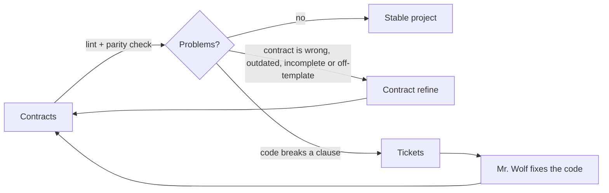
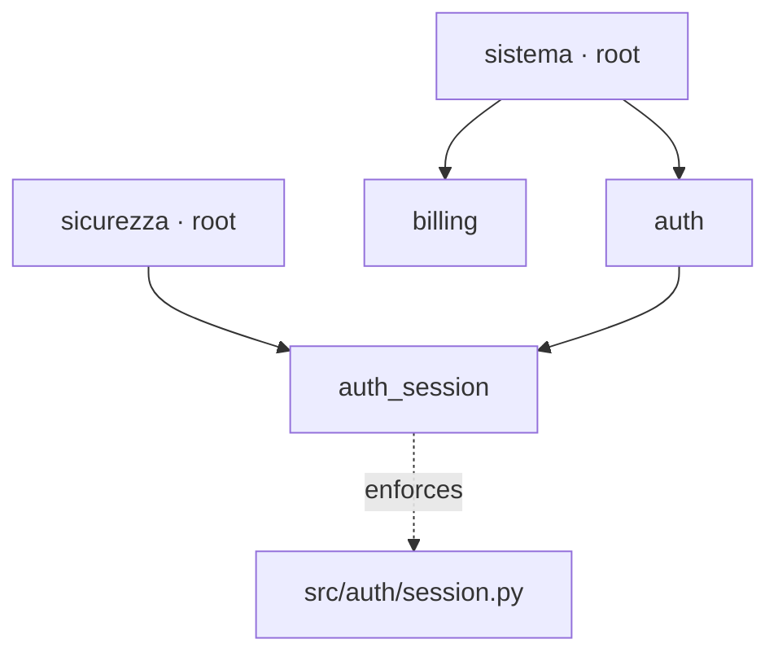
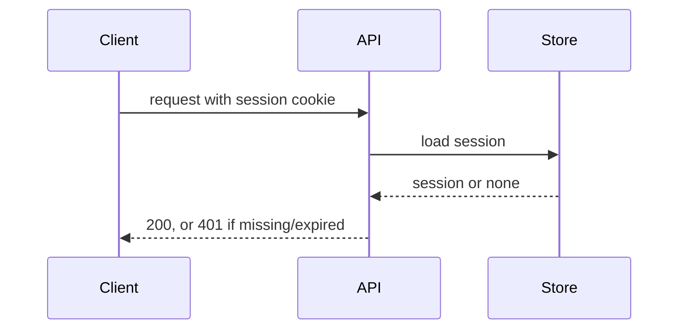

<!-- contract-flow-workspace -->
# Contract-flow workspace

This folder holds the **contracts** that document this project, the **tickets** that track where the project does not match them yet, and the **handoffs** that let a new session pick up where the last one stopped. The checks that verify the contracts live in the tests folder named in the configuration.

## How the flow works



| Problem | Solved by |
|---|---|
| The contract does not reflect the latest requests | `contract-refine` |
| The contract does not follow the template | `contract-refine` |
| Something the parts do or expose has no clause (a gap) | `contract-refine` |
| The code breaks a clause | `parity-check`, then a code ticket, solved by Mr. Wolf |

1. A **contract** documents one part of the project: what it is for, how it works (shown with diagrams and tables), and the **clauses** that bind the parts it enforces. It is written to be read by a person, not only checked by a tool.
2. A contract leaves **no grey zone**: everything the parts do, expose, accept, return or must never do is covered by a clause, or declared out of the contract with the reason.
3. Contracts form a **graph**: a root documents the whole system, the contracts it enforces document its parts, down to leaves that enforce files. A contract can implement more than one parent, so a shared requirement (security, code quality) is written once. Every file of the contracted domain is enforced by some leaf contract.
4. Every clause has a **verification**: how it is proven, with a type chosen from a closed list. A clause that cannot be verified is not accepted.
5. **`contract-tools`** is the one script that does the mechanical work: it lints the contracts and tickets, runs the verifications, and writes everything structured (see **contract-tools**). A contract that fails the lint is sent to `contract-refine` before anything else is checked.
6. A **parity check** runs the verifications and lists every discrepancy. **Every discrepancy becomes a ticket the moment it is found**; nothing is left in a message.
7. The project is **stable** when every contract passes the lint, every clause passes, no file is uncontracted and no ticket is open or rerouted.

To start or resume, run `/contract-flow`.

## Configuration

<!-- Filled in by contract-init. Edit by hand or rerun contract-init. -->

| Setting | Value |
|---|---|
| Workspace | {{this folder}} |
| Tests folder | {{where verification scripts and check files live}} |
| Script runner | {{how scripts are run, one command in backticks, e.g. `bash`, `pwsh`, `python3`, `npm test --`}} |
| Contracted domain | {{paths governed by contracts, each in backticks, folders ending in `/`}} |
| Excluded | {{paths out of scope, each in backticks, never reported as uncontracted, or "none"}} |
| Extra verification types | {{types added to the closed list below, or "none"}} |
| Hooks | {{where verifications also run, e.g. CI, pre-commit, or "none"}} |
| Existing documentation | {{docs that already exist and what they contain}} |

## Folders

| Folder | Contents |
|---|---|
| `contracts/` | All contracts, in one folder with no subfolders, plus the generated `INDEX.md`. |
| `tickets/` | One file per ticket, `T-<name>.md`. Closed tickets stay here with their status. |
| `handoff/` | Session handoffs. The most recent one says what to do next. |
| `scope.txt` (in the workspace) | The contracts and files touched in this flow, one per line. Written only by `contract-tools scope`. |
| tests folder | `contract-tools.py`, plus one verification per clause: `<contract id>/<clause name>.<ext>` (not for `covered-by` clauses). |

## Names

Clauses and tickets are named, never numbered.

| Rule | Example |
|---|---|
| At most **3 words**, joined by `_`, only `a-z`, `0-9` and `_` | `session_expires`, `T-timeout_too_long` |
| Written in the language of the project | |
| Describes what it means, so a reader of another contract understands a reference without opening it | |
| A **contract ID** is its file name without `.md`, with the same rules: `auth_session`. It is unique in the project. | `contracts/auth_session.md` |
| A clause name is unique inside its contract; a ticket name is unique in the project | |
| If a name is taken, reword it, never add a number | |
| A name never changes once written, unless every reference is updated | |

A clause is referred to as `<contract id>#<clause name>`, e.g. `auth_session#session_expires`. A ticket is referred to by its ID, e.g. `T-timeout_too_long`.

## Contract graph

All contracts sit in `contracts/`, one file each, with no subfolders. How they relate is written in the header, never in folders.



| Kind | `implements` (parents) | `enforces` |
|---|---|---|
| **Root** (`root: yes`) | none | contracts or files |
| **Intermediate** | one or more contracts | contracts only |
| **Leaf** | one or more contracts | files and folders of the project only |

- **Both fields on both sides.** If `a` implements `b`, then `b` enforces `a`. The lint rejects an edge written on one side only. A contract always enforces something.
- **Files or contracts, never both.** Paths contain `/` or `.` (folders end with `/`); anything else is a contract ID.
- **No cycles.** Several parents are allowed. A requirement shared by many contracts (security, quality) is a contract that all of them implement.
- **Level of abstraction** is not written anywhere: the lint computes it as the distance from the roots (the longest chain upwards) and shows it in `INDEX.md`.
- **Navigation.** The lint writes, under the title of every contract, a block with its level and links to the contracts it implements and enforces, and it writes `contracts/INDEX.md` with the map, the levels and a table file → leaf contract. Never edit these by hand.
- **Coverage.** Every file of the contracted domain that is not excluded must be enforced by at least one leaf contract. A file enforced by no leaf is an **uncontracted zone**.
- **Large contracts.** When a contract grows too large to read in one go (roughly: more than ~300 lines, more than ~15 enforced files, or several parts a reader would want to study separately), it is split: it keeps the overview and new contracts take the detail. The split is always proposed and confirmed, never automatic.
- **Built in either direction.** Top-down, a parent is written first and names the contracts it will enforce. Bottom-up, leaves are written from existing code or documents, and parents are added above them later; until then the lint reports them as orphans.

## Contract format

A contract has **five sections in a fixed order** and a **fixed header** (`name`, `implements`, `enforces`, and `root: yes` on a root). These are the only rigid parts. Inside the sections, write freely, at the abstraction level of the contract, as long as it is shown more than told.

### Writing rules

- **Simple language.** Short sentences, everyday words. One idea per paragraph.
- **Show, don't only tell.** Prefer a diagram or a table to a list, and a list to a paragraph. Use:
  - `mermaid` diagrams for flows, sequences, states, dependencies, structure
  - tables for options, fields, parameters, states, responsibilities, views of the same data from different sides
  - trees (code blocks) for folder layouts
  - short code snippets for interfaces and examples
- **No grey zones.** Before writing the clauses, list every responsibility, entry point, input, output, error case, configuration and dependency of the parts at this level. Each one gets a clause, or is declared out of the contract with the reason. Detail too fine for this level goes into a child contract.
- **Few entries, each useful.** A table row or a note that nobody could act on or verify is removed.
- **No undefined terms.** A term whose meaning the text does not explain goes into **Notes**.

### Template

~~~markdown
---
name: Session handling            # at most 3 words
implements: [auth, sicurezza]     # parent contracts; empty only on a root
enforces:                         # child contracts (intermediate, root) or files (leaf); never both
  - src/auth/session.py
  - src/auth/store/
---

# Session handling

## Purpose
<what this part is for and why it exists, in 2-4 lines>

## View
<at least one diagram, table or tree that shows how the part works: flows, states,
data, structure, interface. Extra sections (decisions, examples, interface...) may
follow here as ### headings.>



| State | Meaning | Next |
|---|---|---|
| active | used in the last 30 min | active, expired |
| expired | idle for 30 min | none |

## Clauses

| Name | Clause |
|---|---|
| `no_session_401` | A request without a valid session gets 401. |
| `session_expires` | A session expires after 30 minutes of inactivity. |
| `no_password_logs` | Passwords never appear in logs. |

## Verification

| Name | Type | Proves | File |
|---|---|---|---|
| `no_session_401` | interface | the API answers 401 with no cookie, an invalid one, an expired one | `auth_session/no_session_401.py` |
| `session_expires` | unit | a session idle for 30 min is rejected | `auth_session/session_expires.py` |
| `no_password_logs` | ai-check | no log call can print a password-like value | `auth_session/no_password_logs.md` |

## Notes
| Term | Meaning |
|---|---|
| session store | <what it is> |
| `refresh()` | <what it does> |
~~~

Only **Notes** is optional; write it when the text leaves a term unexplained.

### Clauses

- A clause states **one** checkable fact about the enforced files, precise enough that nobody can claim the contract allows what it does not say. High in the tree clauses are coarse ("client and server talk only over HTTP"); at the leaves they are exact.
- Names follow the rules in **Names**. A removed clause leaves nothing behind.
- A contract that `implements` another must not contradict its clauses. Every clause of a contract that enforces contracts is covered by clauses of those contracts (see `covered-by`).

### Verification

Every clause has **exactly one** row in **Verification**, with a type from this closed list (plus any extra type added in the configuration):

| Type | Proves | File | Passes when |
|---|---|---|---|
| `unit` | one function or class in isolation | script in the tests folder | exit code 0 |
| `interface` | what a part exposes (API, CLI, file format) as a caller sees it | script | exit code 0 |
| `integration` | several parts working together | script | exit code 0 |
| `end-to-end` | a whole user-visible flow | script | exit code 0 |
| `script` | any other deterministic check: file structure, grep, static rule | script | exit code 0 |
| `ai-check` | what no script can decide (readability, intent, absence of something across many files) | check file (`.md`) | the model finds every criterion met, citing path and line |
| `covered-by` | a clause of a contract that enforces **contracts**: the written clauses of those contracts satisfy it | the clauses that cover it, as `<contract id>#<clause>`, comma separated | the lint finds each clause in an enforced contract, and the model judges they are enough, citing their text |

Use `ai-check` only when no deterministic type can decide the clause. `covered-by` is the normal type for a root or intermediate contract and is not allowed on a leaf; a root or intermediate clause may use `ai-check` only with a stated reason. A clause shared by many contracts (such as security) is covered by clauses in each contract that implements it.

An `ai-check` file has this shape:

```markdown
# auth_session#no_password_logs

## Look at
- src/auth/**, every call to the logger

## Criteria
1. No log call receives a password, a hash or a form field named like one.
2. Error messages for failed logins do not echo the input.

## Fails when
Any log call could print a password-like value. Cite the line.
```

A script exits 0 when the clause holds and prints why when it does not. The **Hooks** setting says where else the verifications run (CI, pre-commit...); the parity check always runs them.

A clause with no verification row, or whose file is missing, is a discrepancy.

### Lint

`contract-tools lint` checks everything that a script can decide, and nothing else:

| Check | Fails when |
|---|---|
| Header | `name` missing or over 3 words; `implements` or `enforces` missing; `implements` empty without `root: yes`, or `root: yes` with parents; `enforces` empty, mixing files and contracts, or naming a path or contract that does not exist |
| Graph | an edge written on one side only; a cycle; a contract in a subfolder; a file name that breaks the rules in **Names** |
| Sections | the five sections are not present in this order (Notes may be absent), or one still holds `_to be written_` |
| View | it has no diagram, table or tree |
| Names | a clause or ticket name breaks the rules in **Names**, or is not unique |
| Verification | a clause has no row or more than one, a row has no clause, the type is not in the list, the file does not exist, `covered-by` is used on a leaf or names a clause that is not in an enforced contract |
| Stale files | a file in `<tests folder>/<contract id>/` that no Verification row cites |
| References | a markdown link to a file or heading that does not exist; a path in backticks that does not exist; a `<contract id>#<clause>` that does not exist; a `file:line` whose line is past the end of the file. Code blocks are not checked. |
| Size | a contract over 300 lines or over 15 enforced entries: propose a new level |
| Coverage | a file of the **Contracted domain** (not **Excluded**) that no leaf contract enforces, printed as `ZONE` |
| Tickets | see **Ticket format** |

Run it from the project root: `<script runner> <tests folder>/contract-tools.py lint`. It also regenerates the links block of every contract and `INDEX.md`, so every file a contract enforces and every verification file is a link, and `INDEX.md` links each file to its leaf contracts. It does not judge language or completeness: the parity check judges completeness.

## contract-tools

One script, `contract-tools.py` in the tests folder, run from the project root. It finds the workspace through the `Contract-flow workspace:` line in `CLAUDE.md` or `AGENTS.md`, and reads the **Configuration** table above (script runner, domain, exclusions, extra types).

**Agents write prose only**: Purpose, View, Notes, and the text of tickets. Everything structured goes through the tool, and every command that edits ends by running the lint on the result, so a mistake is reported at once.

| Command | What it does |
|---|---|
| `lint` | The checks above; regenerates links blocks and `INDEX.md` |
| `verify [--contract ID]` | Runs every scripted verification; `ai-check` and `covered-by` are reported as `JUDGE`, a stub as `FAIL` |
| `contract new <id> --name N --implements a,b --enforces x` | Creates a skeleton with `_to be written_` sections and writes the other side of each edge |
| `contract rename <old> <new>` | Renames the file and the tests folder, and every reference in contracts and tickets |
| `edge add\|remove <parent> <child>` | Writes `enforces` on the parent and `implements` on the child |
| `files add\|remove <contract> <path>...` | Edits the `enforces` of a leaf |
| `root set\|unset <contract>` | Marks or unmarks a root |
| `clause add <contract> <name> --text T --type TYPE [--proves P] [--file F] [--covers c#k] [--ticket NAME]` | Adds the Clauses row and the Verification row, creates a **stub that fails** for a script or `ai-check` file, and with `--ticket` opens the ticket on the new clause |
| `clause rename <contract> <old> <new>` | Renames the rows, the verification file and every `<contract>#<old>` |
| `clause remove <contract> <name>` | Removes the rows and the file, and makes an open ticket on it `obsolete` |
| `ticket new\|log\|status\|direction\|reopen\|list\|sweep` | The only way to write tickets (see **Ticket format**) |
| `scope add\|clear\|list` | Keeps `scope.txt` |
| `summary` | Tickets by status and direction, scope, lint result, and whether anything is open |
| `handoff --stopped-at S [--why W --decisions D --next N --skills K]` | Writes the handoff file with the fixed sections, scope and tickets filled in |

## Ticket format

A ticket is created and changed **only with `contract-tools ticket`**, which writes the front matter and the log with the time. The agent writes the text of the four sections.

```markdown
---
id: T-timeout_too_long
status: open            # open | resolved | rerouted | obsolete
direction: code         # code | contract | escalate
contract: auth_session
clause: session_expires
---

# Sessions expire after one hour instead of 30 minutes

## Problem
<in plain words: what is wrong and why it matters>

## Conflict
- [auth_session](../contracts/auth_session.md): "A session expires after 30 minutes of inactivity."
- `src/auth/session.py:42`: `SESSION_TIMEOUT = 3600`

## Verification
<script or check run, and what it showed>

## Proposed direction
code: the contract reflects the agreed requirement; the constant is wrong.

## Log
- 2026-10-28T14:32 · parity-check · opened · code: verification fails
- 2026-10-28T15:10 · mr-wolf · status_changed · open -> resolved: constant set to 1800
```

**One ticket per clause**, for the whole life of the project. A clause that fails again reopens its ticket; `ticket new` on a clause that already has one reopens it (or says it is open) instead of creating a second.

**Log.** One line per event: `- <YYYY-MM-DDTHH:MM> · <who> · <event> · <detail>`, newest last, never edited.

| Event | Detail |
|---|---|
| `opened` | `<direction>: <reason>`. Always the first line, and only there. |
| `direction_changed` | `<from> -> <to>: <reason>` |
| `status_changed` | `<from> -> <to>: <reason>` |
| `reopened` | `<reason>`; the status becomes `open` |
| `note` | free text |

**States.**

| From | To | By |
|---|---|---|
| `open` | `resolved`, `rerouted`, `obsolete` | `ticket status` |
| `rerouted` | `resolved`, `obsolete` | `ticket status`; or `open` by `ticket reopen` |
| `resolved`, `obsolete` | `open` | `ticket reopen` |

**Sweep.** `ticket sweep` runs at the start of every parity check:
- an `open` or `rerouted` ticket whose clause or contract no longer exists becomes `obsolete`;
- an `open` ticket with direction `code` whose scripted verification now passes becomes `resolved`;
- a `resolved` ticket whose scripted verification fails again is reopened, with direction `code`.

**The lint** fails a ticket when: the file name, `id`, `status` or `direction` are off; the sections are not Problem, Conflict, Verification, Proposed direction, Log, or one is still `_to be written_`; the log is empty, a line does not follow the form, the first event is not `opened`, times go backwards, a step is not allowed by the table above or does not start from the state the log is in, a change has no reason, or `status` and `direction` do not match where the log ends; a second ticket exists for the same clause; an `open` ticket points at a clause that no longer exists; a reference in its text does not resolve.
