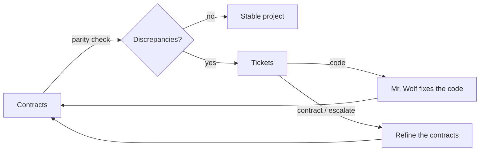
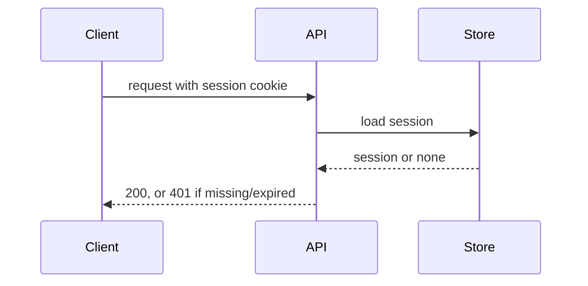

<!-- contract-flow-workspace -->
# Contract-flow workspace

This folder holds the **contracts** that document this project, the **tickets** that track where the project does not match them yet, and the **handoffs** that let a new session pick up where the last one stopped. The checks that verify the contracts live in the tests folder named in the configuration.

## How the flow works



1. A **contract** documents one part of the project: what it is for, how it works, what it exposes, and the **constraints** it imposes on its targets. It is written to be read by a person, not only checked by a tool.
2. Contracts are nested: the root documents the whole system, its children document its parts, down to single files. Every file of the contracted domain is a target of some contract.
3. Every constraint has a **verification**: a script (deterministic) or a check file (judged by the model). A constraint that cannot be verified is not accepted.
4. A **parity check** runs the verifications, finds uncontracted files and lists every discrepancy. On request, discrepancies become **tickets** with a direction: `code`, `contract` or `escalate`.
5. Code tickets are resolved by **Mr. Wolf**. Contract and escalate tickets go back to the contracts, always after a grilling session.
6. The project is **stable** when every constraint passes and no file is uncontracted.

To start or resume, run `/contract-flow`.

## Configuration

<!-- Filled in by contract-init. Edit by hand or rerun contract-init. -->

| Setting | Value |
|---|---|
| Workspace | {{this folder}} |
| Tests folder | {{where verification scripts and check files live}} |
| Script runner | {{how scripts are run, e.g. `bash`, `pwsh`, `python`, `npm test --`}} |
| Contracted domain | {{paths governed by contracts}} |
| Excluded | {{paths out of scope, never reported as uncontracted, or "none"}} |
| Existing documentation | {{docs that already exist and what they contain}} |

## Folders

| Folder | Contents |
|---|---|
| `contracts/` | The contract tree. The children of `x.md` live in the folder `x/` next to it. |
| `tickets/` | One file per ticket, `T-<nnnn>-<slug>.md`. Closed tickets stay here with their status. |
| `handoff/` | Session handoffs. The most recent one says what to do next. |
| tests folder | One script or check file per verification, named after the contract: `<contract id>/<constraint>.<ext>`. |

## Contract tree

```
contracts/
├── system.md              id: system (the root)
└── system/
    ├── auth.md            id: system/auth
    ├── auth/
    │   └── session.md     id: system/auth/session
    └── billing.md         id: system/billing
```

- A contract's **ID is its path** inside `contracts/` without `.md`. Its parent is the contract named after the folder it sits in.
- A contract with no children is a single file; its folder is created with its first child.
- **New abstraction level.** When a contract grows too large to read in one go (roughly: more than ~300 lines, more than ~15 targets, or several parts a reader would want to study separately), it is split: the contract keeps the overview and its children take the detail. The split is always proposed and confirmed, never automatic.
- **Coverage.** Every file of the contracted domain that is not excluded must be a target of at least one leaf contract. A file targeted by no contract is an **uncontracted zone**.

## Contract format

A contract is documentation first. Only the header and the **Constraints** table have a fixed shape; everything in between is written freely, at the abstraction level of the contract.

### Writing rules

- **Simple language.** Short sentences, everyday words. One idea per paragraph.
- **Show, don't only tell.** Prefer a table to a list, a list to a paragraph, and a diagram to a description of a flow. Use what Markdown offers:
  - tables for options, fields, parameters, states, responsibilities
  - `mermaid` diagrams for flows, sequences, states, dependencies
  - trees (code blocks) for folder layouts
  - short code snippets for interfaces and examples
- **Complete.** Document everything the targets do at this level: every responsibility, entry point, input and output, error case, configuration and dependency. A reader must not need to open the code to understand what the part does. Detail too fine for this level goes into a child contract, not away.
- **No undefined terms.** Every term, function, acronym or name whose meaning is not explained in the text goes into **Notes**.

### Template

~~~markdown
---
realises: [system/auth]           # contracts this one respects (its parent and any other); not on the root
targets:                          # required: everything this contract constrains
  - src/auth/session.py
  - src/auth/store/
---

# Session handling

## Purpose
<what this part is for and why it exists, in 2-4 lines>

## How it works
<free documentation: overview, flows, states, data, decisions and their reasons.
Tables and diagrams preferred. Example:>



| State | Meaning | Next |
|---|---|---|
| active | used in the last 30 min | active, expired |
| expired | idle for 30 min | none |

## Interface
<what it exposes: functions, endpoints, commands, files, events. Table preferred, or "None".>

## Constraints

| ID | Constraint | Verification | Enforcement |
|---|---|---|---|
| C1 | A request without a valid session gets 401. | script: `system/auth/session/C1.sh` | CI, parity check |
| C2 | A session expires after 30 minutes of inactivity. | script: `system/auth/session/C2.sh` | parity check |
| C3 | Passwords never appear in logs. | check: `system/auth/session/C3.md` | parity check |

## Notes
| Term | Meaning |
|---|---|
| session store | <what it is> |
| `refresh()` | <what it does> |
~~~

### Constraints

- A constraint states **one** checkable fact about the targets. High in the tree constraints are coarse ("client and server talk only over HTTP"); at the leaves they are precise.
- IDs (`C1`, `C2`…) never change once written. A removed constraint leaves a gap. Elsewhere it is referenced as `<contract id>#C<n>`, e.g. `system/auth/session#C2`.
- A contract that `realises` another must not contradict its constraints, and every constraint of a parent must be backed by at least one child constraint or by the parent's own verification.

### Verification

Every constraint has exactly one verification, stored in the tests folder.

| Kind | File | Passes when |
|---|---|---|
| `script` | An executable script (any language the **Script runner** supports). Deterministic: same targets, same result. | It exits with code 0. Its output explains any failure. |
| `check` | A Markdown check file, judged by the model. For constraints no script can decide (readability, intent, absence of something across many files). | The model, following the file, finds every criterion met, citing path and line. |

A check file has this shape:

```markdown
# system/auth/session#C3: passwords never appear in logs

## Look at
- src/auth/**, every call to the logger

## Criteria
1. No log call receives a password, a hash or a form field named like one.
2. Error messages for failed logins do not echo the input.

## Fails when
Any log call could print a password-like value. Cite the line.
```

**Enforcement** says when the verification runs: `parity check` (always), plus `CI`, `pre-commit` or other hooks if the project wires the script in.

A constraint with no verification, or whose verification file is missing, is itself a discrepancy.

## Ticket format

```markdown
---
id: T-0007
status: open            # open | resolved | rerouted | obsolete
direction: code         # code | contract | escalate
contract: system/auth/session
constraint: C2
---

# Sessions expire after one hour instead of 30 minutes

## Problem
<in plain words: what is wrong and why it matters>

## Conflict
- contracts/system/auth/session.md#C2: "A session expires after 30 minutes of inactivity."
- src/auth/session.py:42: `SESSION_TIMEOUT = 3600`

## Verification
<script or check run, and what it showed>

## Proposed direction
code: the contract reflects the agreed requirement; the constant is wrong.

## Log
<!-- appended by whoever works on the ticket, newest last -->
- 2026-10-28 · parity-check · opened
```
